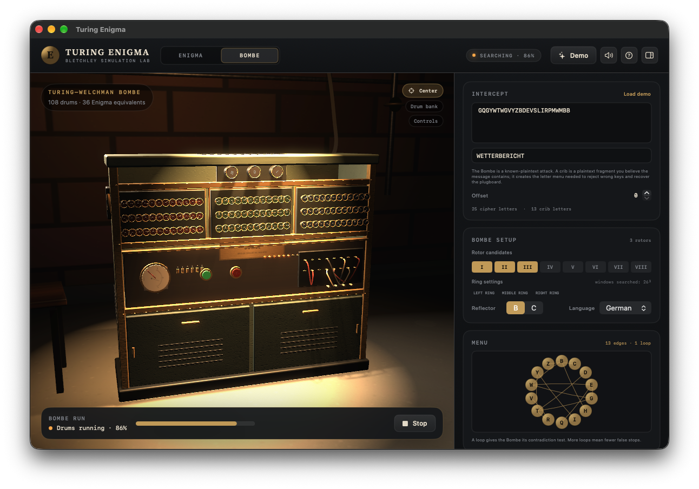

# Turing Enigma

A native macOS application that simulates a historically accurate **Enigma machine** and
the **Turing–Welchman Bombe**. Both machines are rendered as detailed, interactive 3D
models powered by SceneKit, with every configurable element editable via the 3D viewport
and a SwiftUI inspector panel.



The app can encipher a message on the Enigma and recover it with the Bombe in one
coherent demo flow.


---

## Features

### Enigma Mode

- **3D Enigma I / M3 / M4** on a walnut desk inside a fully modelled room.
- Clickable keys, lamps, plugboard sockets, rotor windows, and reflector.
- Hardware keyboard input while the viewport has focus.
- Inspector for machine type, reflector, rotor order, ring settings, window settings,
  plugboard pairs, and message controls.
- Animated rotor stepping (with historical double-stepping), key depression, and lamp
  glow.
- Plugboard cables rendered with curved Bézier geometry.

### Bombe Mode

- **Real-scale 3D cabinet** (2.1 m × 1.98 m × 0.61 m) in a Bletchley Park–style hut.
- 3 banks × 36 drums (108 drums), 3 indicator drums, controls, lamps, jacks, cables,
  vents, and casters.
- Crib, crib offset, rotor candidates, ring settings, reflector, and known plugboard
  pair inputs.
- Menu graph construction, run/stop, progress tracking, stops list, checking panel, and
  apply-to-Enigma action.
- Drums spin while solving, then decelerate and settle on a stop.
- The top stop's deciphered text appears in a completion toast, the run console, and
  every stop card.

### 3D Rendering

- **PBR materials**: diffuse, roughness, metalness, normal maps, clearcoat, and emission.
- **Procedural textures**: wood grain, crinkle paint, brushed metal, bakelite, ivory,
  glass, paper, cable cloth, brick, and concrete.
- Three-point lighting, soft shadows, SSAO, HDR bloom, and practicals.
- Custom orbit camera with full 360° horizontal rotation, pan, zoom, presets, and Center
  reset.
- Back-wall auto-hide on rear orbit so the model is always the focus.
- Generated cube-map lighting environment.

### Demo Scenario

The app ships with a built-in weather report demo:

| Parameter   | Value                              |
|-------------|------------------------------------|
| Plaintext   | `WETTERBERICHTFUERDIENACHT`        |
| Crib        | `WETTERBERICHT` at offset 0        |
| Rotors      | III  II  I (left to right)         |
| Reflector   | B                                  |
| Rings       | A A A                              |
| Windows     | E H L                              |
| Plugboard   | W↔E  T↔R  B↔I  C↔H                |
| Ciphertext  | `GQGYWTWGVYZBDEVSLIRPMWMBB`       |

The Bombe recovers all four plugboard pairs and the correct rotor order in a single run.

---

## Requirements

- **macOS 15** or later
- **Xcode 16+** with the macOS SDK
- **XcodeGen** (`brew install xcodegen`)
- No third-party dependencies. No network access at runtime.

---

## Getting Started

```bash
# Clone the repo
git clone <repo-url> && cd turing-enigma

# Generate the Xcode project
make generate

# Build (debug)
make build

# Run the app
make run
```

---

## Make Targets

| Target              | Description                                                    |
|---------------------|----------------------------------------------------------------|
| `make generate`     | Regenerate `TuringEnigma.xcodeproj` from `project.yml`         |
| `make icon`         | Render `AppIcon.icns` (also runs automatically before build)   |
| `make build`        | Debug build                                                    |
| `make test`         | Run `TuringEnigmaCoreTests` (engine & solver)                  |
| `make uitest`       | UI smoke test (requires Developer Mode)                        |
| `make check`        | Core tests + snapshots + viewport, flow, and UI action checks  |
| `make run`          | Launch the application                                         |
| `make snapshot`     | Offscreen visual QA renders                                    |
| `make viewport-check` | Headless scene, click, gesture, and camera checks           |
| `make flow-check`   | Headless demo encipher → Bombe → apply check                   |
| `make ui-check`     | Headless SwiftUI button action check                           |

---

## Project Structure

```
Sources/
├── Core/
│   ├── Enigma/       # Enigma engine (stepping, wiring, plugboard)
│   ├── Bombe/        # Bombe solver (menu builder, constraint propagation)
│   └── Scenarios/    # Demo scenario definitions
├── App/
│   ├── UI/           # SwiftUI views and inspectors
│   ├── Scene/        # SceneKit 3D scenes and camera controller
│   ├── Audio/        # Sound effects
│   └── Resources/    # App icon and assets
Tests/
├── CoreTests/        # Engine and solver unit tests
└── UITests/          # Launch smoke test
Scripts/              # Icon generation and build helpers
```

### Targets

| Target                  | Description                               |
|-------------------------|-------------------------------------------|
| `TuringEnigmaCore`      | Foundation-only engine and solver library  |
| `TuringEnigma`          | SwiftUI app with SceneKit 3D scenes       |
| `TuringEnigmaCoreTests` | Engine and solver tests                   |
| `TuringEnigmaUITests`   | Launch smoke test                         |

---

## Viewport Controls

| Action                      | Input                                       |
|-----------------------------|---------------------------------------------|
| **Orbit**                   | Click and drag                              |
| **Pan**                     | Right-drag, or Option/Shift + drag          |
| **Zoom**                    | Scroll wheel or pinch gesture               |
| **Click**                   | Click on a key, lamp, rotor, plug, or drum  |
| **Type** (Enigma only)      | Hardware keyboard while viewport is focused |
| **Deselect**                | Escape key                                  |
| **Center**                  | Center overlay button (restores default)    |
| **Presets**                 | Close-up preset buttons beside Center       |

Zoom is clamped to keep the camera inside the room:
- Enigma: 0.55 m – 2.80 m
- Bombe: 1.05 m – 5.80 m

---

## Technical Notes

- **Engine correctness over visuals**: the Enigma stepping and Bombe solver are validated
  against known test vectors before any rendering work.
- **Historical wiring**: rotors I–VIII, Beta, Gamma; reflectors B, C, thin B, thin C.
- **Double-step**: the M3/M4 double-step anomaly is correctly implemented.
- **Bombe solver**: builds a menu from crib/ciphertext pairs, enumerates rotor orders and
  26³ window settings, and solves plugboard constraints through propagation (diagonal-board
  behaviour). Stops are ranked by language score.
- **No external assets**: all geometry, textures, and the app icon are generated
  procedurally at build time or at runtime.
- **Signing**: ad-hoc local signing, sandbox disabled for development.

---

## License

MIT License.
